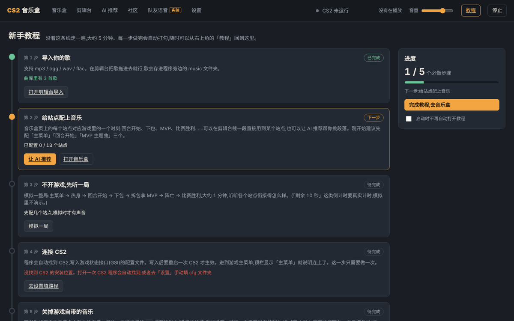
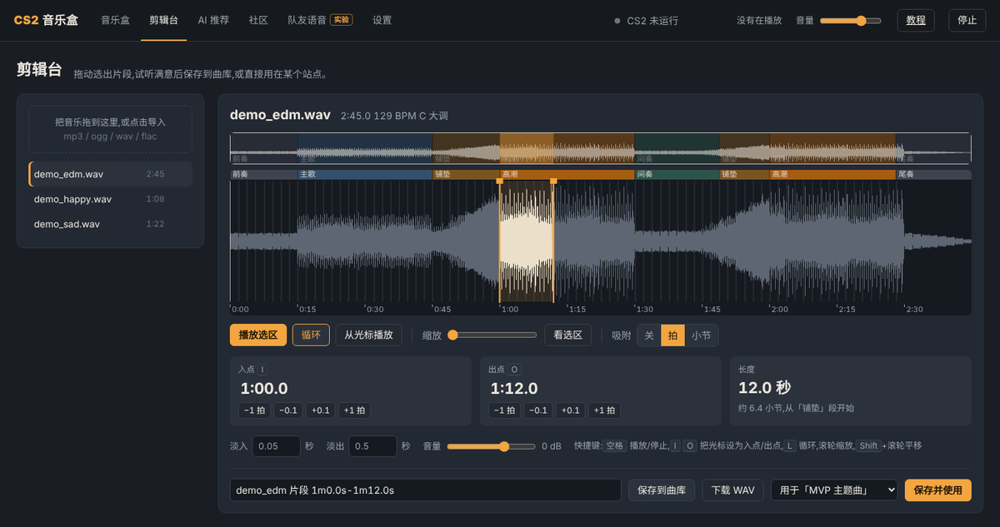
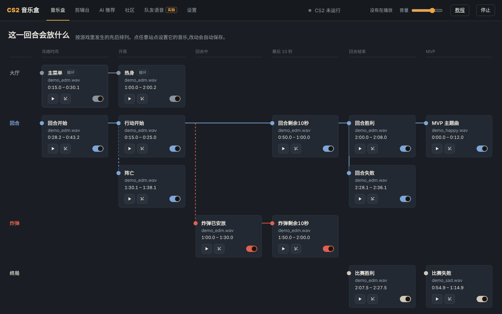
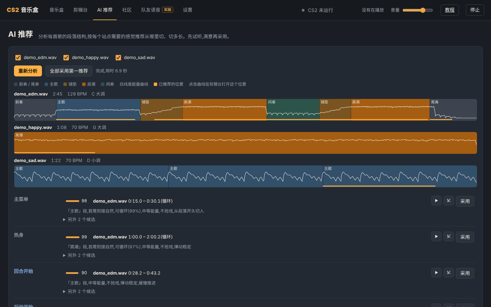
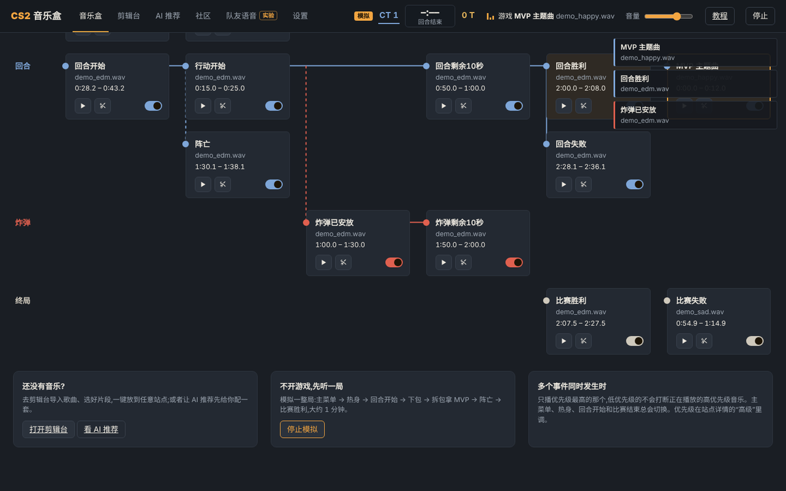
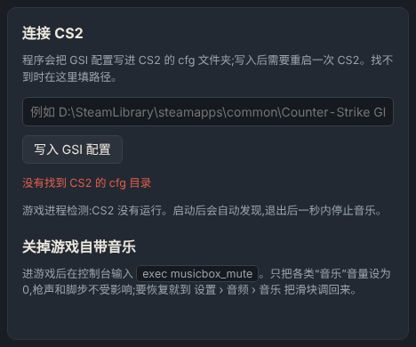
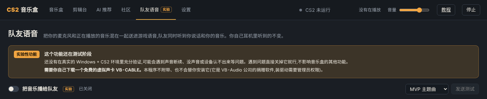

# CS2 音乐盒 · 新手教程

用你自己的歌,替代 CS2 里的音乐盒(Music Kit):回合开始、下包、拿 MVP、赢下比赛……每个时刻放你挑好的那一段。

整个设置大约 **5 分钟**。程序第一次打开时会自动显示一个「新手教程」页面,每做完一步会自动打勾;这份文档是它的图文版,内容更细一些。

**你需要:**

- Windows 电脑和 CS2
- 你想用的歌(mp3 / ogg / wav / flac 都行)
- 一副耳机(只有用「队友语音」时才必须)

**它不会做的事:** 不改游戏文件、不读写游戏内存、不注入游戏,也不向游戏发送任何按键。它只读取 Valve 官方的游戏状态接口(GSI,Game State Integration)推送的数据——也就是你屏幕上本来就能看到的信息。

---

## 第 0 步:下载和启动

1. 下载 `CS2MusicBox-windows.zip`,**解压到任意文件夹**,比如 `D:\CS2MusicBox`。
    - 不要放进 `C:\Program Files`(那里不能随便写文件,程序会把数据改存到 `%LOCALAPPDATA%\CS2MusicBox`,找起来麻烦)。
2. 双击 `CS2MusicBox.exe`。
    - 如果弹出「Windows 已保护你的电脑」:点「更多信息」→「仍要运行」。这是因为程序没有付费的代码签名证书。
    - 杀毒软件偶尔会误报 Python 打包的程序,可以把这个文件夹加进白名单。
3. 会出现一个**黑色窗口**(运行日志),同时浏览器自动打开控制面板 `http://127.0.0.1:31777`。
    - **关掉黑色窗口 = 退出程序。** 程序已经在运行时再双击 exe,会直接打开控制面板。
    - 你的配置、曲库都存在 exe 旁边。升级新版本时,用新的 `CS2MusicBox.exe` 和 `_internal` 文件夹覆盖旧的就行,数据不会丢。

第一次打开会直接进入新手教程:



右上角的「教程」按钮随时可以回到这里。

---

## 第 1 步:导入你的歌

打开「**剪辑台**」页,把歌**拖进左上角的虚线框**(或者点它选择文件)。歌会被复制到程序旁边的 `music` 文件夹。

## 第 2 步:剪一段,放到某个站点

在剪辑台左边点一首歌,右边会显示它的波形,还会自动识别**段落**(前奏、主歌、铺垫、高潮……)和**节拍**:



- **在波形上拖动**选出一段;拖选区边缘调整起止,拖选区中间整体移动。
- **吸附**(关 / 拍 / 小节):开着时切点会自动对齐节拍,切出来不会“抢拍”。
- 入点、出点可以直接输入(`1:05.2` 或 `65.2`),也可以按 ±0.1 秒、±1 拍微调。
- 设好淡入、淡出、音量后:
    - **保存并使用**:存成一个新文件,并直接放到右边下拉框选中的站点(最常用)
    - **保存到曲库**:只存文件,稍后再用
    - **下载 WAV**:存到你电脑的下载文件夹

快捷键:`空格` 播放/停止选区,`I` / `O` 把光标设为入点 / 出点,`L` 循环,滚轮缩放,`Shift`+滚轮平移,`Esc` 停止所有声音。

> **片段长度建议**:MVP 10–12 秒;回合开始 10–15 秒;下包 30 秒左右(炸弹 40 秒,最后 10 秒交给「炸弹剩余10秒」);主菜单和热身用整首并打开“循环”。

## 第 3 步:看看「音乐盒」

「**音乐盒**」页是一张“回合线路图”:13 个站点按一个回合里发生的先后排列,四条轨道分别是**大厅、回合、炸弹、终局**。



- 点任意站点,右侧会滑出详情:选曲目、起止时间、音量、淡入淡出、是否循环。**改了就自动保存。**
- 每个站点右下角的开关可以临时停用它;▶ 试听,✂ 在剪辑台里打开这一段。
- **同一时刻触发多个事件时,只放优先级最高的那个**(例如拆包胜利同时拿 MVP → 放 MVP)。低优先级的不会打断正在放的高优先级音乐;主菜单、热身、回合开始和比赛结束总会切换。

| 站点 | 什么时候响 |
|---|---|
| 主菜单 / 热身 | 回到主菜单 / 进入热身 |
| 回合开始 | 冻结时间(购买阶段)开始 |
| 行动开始 | 冻结时间结束,回合正式开始 |
| 阵亡 | 你被击杀(进入死亡视角) |
| 回合剩余10秒 | 按回合时长**估算** |
| 炸弹已安放 / 炸弹剩余10秒 | C4 被安放 / 按 40 秒炸弹时间**估算** |
| 回合胜利 / 回合失败 | 本回合我方赢 / 输 |
| MVP 主题曲 | 你拿到本回合 MVP |
| 比赛胜利 / 比赛失败 | 整场比赛结束时比较比分 |

## 第 4 步(推荐):让 AI 帮你挑

不想一段一段地剪?打开「**AI 推荐**」,勾选要分析的歌,点「开始分析」(第一次会慢十几秒)。



它会画出每首歌的段落结构,并给每个站点推荐 3 个候选片段和理由——比如 MVP 要高能量、开头有冲击;倒计时要“结尾正好进入高潮”;主菜单要能无缝循环。每个候选都能 ▶ 试听,满意就点「采用」,或者直接「全部采用第一推荐」,之后再微调。

> AI 只看声音特征(能量、节奏、段落),不理解歌词和风格。把推荐当作起点,以你的耳朵为准。

## 第 5 步:不开游戏,先听一局

在「音乐盒」页底部或新手教程里点「**模拟一局**」。程序会模拟一整局:主菜单 → 热身 → 回合开始 → 下包 → 拆包拿 MVP → 阵亡 → 回合失败 → 比赛胜利,大约 1 分钟。



- 顶栏会显示「**模拟**」标记和比分;右上角会滑出每个事件的提示;正在放的站点会高亮。
- 「回合剩余10秒」「炸弹剩余10秒」需要真实计时,模拟里不演示。
- CS2 开着的时候不能模拟(会和真实数据冲突);模拟途中游戏数据来了,模拟会自动停止。

## 第 6 步:连接 CS2

程序启动时会自动找到 CS2 的安装位置,把游戏状态接口的配置文件 `gamestate_integration_musicbox.cfg` 写进 CS2 的 `cfg` 文件夹。**写入后要重启一次 CS2 才生效**,以后就不用管了。

看顶栏中间的状态:

| 顶栏显示 | 意思 |
|---|---|
| CS2 未运行 | 正常,打开游戏就会自动连接 |
| CS2 已启动,等待数据 | 游戏正在加载,进到主菜单就会连上 |
| **需要重启 CS2**(红色) | 配置是在游戏开着的时候写进去的:关掉 CS2 再开一次 |
| 主菜单 / 比分和计时 | 已经连上了 |

如果程序没找到 CS2(装在不常见的位置):**打开一次 CS2**,程序会从正在运行的游戏找到安装位置并自动写入;或者到「**设置**」页手动填写 cfg 文件夹:



路径一般是 `…\steamapps\common\Counter-Strike Global Offensive\game\csgo\cfg`。

## 第 7 步:关掉游戏自带的音乐

不然游戏原来的音乐盒会和你的音乐一起响。进游戏后按 `~` 打开控制台,输入:

```
exec musicbox_mute
```

- 它只把各类“音乐”的音量调成 0,**枪声、脚步声不受影响**。
- 按 `~` 没反应:游戏设置 › 游戏 › 「启用开发者控制台」选「是」。
- 想恢复:游戏设置 › 音频 › 音乐,把滑块调回来。

在新手教程里勾选「我已经在游戏里输入过了」,这一步就完成了。

## 第 8 步:开玩

进一局游戏,音乐会跟着游戏自动切换。退出游戏后 1 秒内音乐会停止。

- 「剩余 10 秒」是按回合开始、下包时间**估算**的(游戏不给玩家倒计时数据)。觉得早了或晚了,到「设置 › 计时」调「提前提示」或「延迟补偿」。
- 只有你自己听得到这些音乐(真正的音乐盒 MVP 全服可听,这个做不到)。想让队友也听到,看下面的「队友语音」。

---

## 附加 A:社区——导入别人的音乐盒

「**社区**」页可以浏览、导入别人分享的音乐盒,也可以分享你的。

- 先填一个社区服务器网址(找分享给你的人要)。用邮箱 + 密码注册,不需要验证邮件。**目前没有找回密码功能,请记住密码。**
- 分享的是“**配方**”:每个站点用哪首歌、从第几秒切、切多长,外加一串“声音指纹”。**不会上传任何音频。**
- 导入时,程序会在你的曲库里找同一首歌——文件名不同、格式不同、前后多几秒都能认出来,并自动对齐时间。缺的歌可以手动选文件;导入后可以一键撤销。
- 免费服务器闲置后会休眠,第一次打开社区页可能要等 1 分钟左右,页面会显示「正在唤醒」。

## 附加 B:队友语音(实验性功能)

把你的麦克风和正在放的音乐混在一起送进游戏语音,队友同时听到你说话和你的音乐;你自己耳机里听到的不变。



> **这是实验性功能**:还没有在真实的 Windows + CS2 环境里充分验证,可能遇到声音断续、没声音、设备认不出来等问题。遇到问题直接关掉它,不影响其他功能。
>
> **需要你自己下载安装虚拟声卡 VB-CABLE。** 程序自己做不出“麦克风设备”(那需要 Windows 内核驱动),所以要借助它中转。本程序**不附带、也不会替你安装**它。

1. 到 [vb-audio.com/Cable](https://vb-audio.com/Cable/) 下载 VB-CABLE(免费的捐赠软件),解压后**右键** `VBCABLE_Setup_x64.exe` →「以管理员身份运行」→ Install,**装完重启电脑**。
2. 控制面板「**队友语音**」页 → 打开「把音乐播给队友」。麦克风选你平时用的那个;「送到」保持自动(CABLE Input)。
3. Steam → 设置 → 语音 → **语音输入设备**,选「**CABLE Output (VB-Audio Virtual Cable)**」。(CS2 的 设置 › 音频 里如果有「语音输入设备」,也选它。)
4. 进游戏照常**按住说话键**——按住的时候队友才听得到,音乐也一样。

想先确认效果:在 Steam 语音设置里点「开始麦克风测试」,同时在「队友语音」页点「**发送测试**」(只送给队友 8 秒,你自己的耳机里听不到),你在麦克风测试里听到的就是队友听到的。

- **你说话时音乐会自动压低**(默认 12 dB),报点不会被盖住。说话检测的灵敏度用麦克风电平表上的白线调:放在“说话时超过、安静时不到”的位置。
- 可以只让部分站点放给队友,比如「只放庆祝时刻」(回合胜利、MVP、比赛胜利)。
- **注意**:队友可以把你静音;一直往语音里放音乐,可能被举报「语音骚扰」导致暂时不能用语音。请用耳机(外放会把游戏声音也录进去),也不要把 Windows 的默认播放设备设成 CABLE Input。

---

## 常见问题

**顶栏一直是「CS2 已启动,等待数据」**
游戏还在加载时这是正常的。进了主菜单还这样:去「设置」看 GSI 配置有没有写入成功,写入后有没有重启过 CS2。

**没有声音**
看黑色窗口里的日志;在「音乐盒」页点站点的 ▶ 试听,确认音频设备正常;检查顶栏的「音量」和站点自己的音量。

**MVP 有时候不响**
阵亡后游戏推送的是你正在观战的队友的数据,看不到你自己的 MVP 数,所以**阵亡状态下拿到的 MVP 可能检测不到**(活着时拿到的可以)。

**端口被占用**
改程序文件夹里 `config.json` 的 `port`,重新启动(GSI 配置会自动更新,之后要重启一次 CS2)。

**第一次 AI 分析很慢**
第一次需要编译分析程序,会多花十几秒,之后就快了。分析结果有缓存,同一首歌第二次不到 1 秒。

**队友说听不到音乐 / 听到回声**
见上面「队友语音」:检查 Steam 的语音输入设备是不是 CABLE Output、说话键有没有按住、那个站点有没有选中;回声多半是麦克风选错了设备,或者 Windows 默认播放设备被设成了 CABLE Input,或者用了外放。
